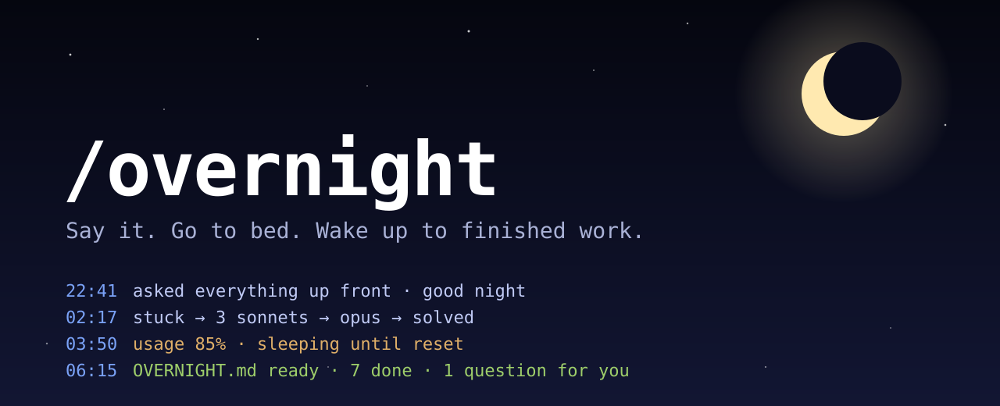
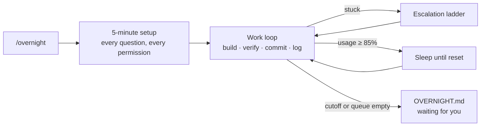

<p align="center">
  
</p>

<p align="center">
  <b>A Claude Code skill that works while you sleep.</b><br>
  Asks for everything in 5 minutes. Works alone until morning. Never wakes you up.
</p>

<p align="center">
  
  
  
</p>

---

## The idea

You have 8 hours of sleep and a queue of work. Your agent has neither.

Type **`/overnight`** before bed. Claude reads your queue, asks every question it will need **right now**, while you're still awake, and then says good night. From that point on, it never blocks on you. When it gets stuck, it doesn't stop. It asks other models. When it runs low on usage, it doesn't die. It sleeps until the window resets. When you wake up, there's one file waiting: what's done, what's blocked, and the one or two decisions only you can make.

```text
> /overnight

Overnight is set up. Here's the plan:
• Now until 2 AM: finish #120 and check every case against the reference.
• Then, in order: #75, #17, and #6 as a plan only, with questions for you.
• If a case fails: I stop that item, write it up with evidence, the rest keeps going.
• Never tonight: deploy, terraform apply, deletes, paid calls, flags on,
  new dependencies, sending messages.
• Usage: pauses at 85% of the 5-hour window and resumes at the reset.
• Wake-up: nothing new starts after 6:15 AM. Summary at the top of OVERNIGHT.md.
• Checks: hourly at :17, first one at 9:41 PM.

Keep the lid open and the Mac plugged in. Good night.
```

## How a night goes



### 1. Five minutes, then silence
Every question goes in **one batch** at the start: queue order, wake-up cutoff, boundaries, what to do on failure. It even runs one harmless instance of each command it will need, so every permission prompt appears **before** you leave, not at 3 AM.

### 2. The escalation ladder
When Claude gets stuck, it doesn't sit there. It climbs:

| Rung | Who | How |
|:---:|---|---|
| 1 | **3 × Sonnet**, in parallel | One finds the root cause, one proposes a simpler path, one plays skeptic |
| 2 | **1 × Opus** | Gets the problem *plus* all three Sonnet answers. Makes the call |
| 3 | **Fable** | For the truly hard ones. Hard budget: **10 questions per night** |
| 4 | **You** | A note in the morning: the question, the options, each model's view, a recommendation |

It stops climbing the moment a rung solves it.

### 3. Usage-aware
At **85%** of the 5-hour window, it stops starting new work, saves state, and sleeps until the reset. Then it picks up exactly where it left off. No half-finished runs, no burned quota.

### 4. Hard boundaries
Unless you explicitly allow it, these **never** happen overnight:

```text
✗ deploy / release / terraform apply      ✗ delete files, branches, data
✗ git push, force-push, history rewrite   ✗ paid API calls
✗ feature flags on, remote config         ✗ new or upgraded dependencies
✗ emails, messages, comments, posts
```

If a task needs one of these, it stops that task and puts it in your morning note. The rest keeps going.

### 5. A report you can trust
Everything lands in `.overnight/<run-id>/` inside your project. It's added to `.git/info/exclude`, so it never gets committed. Outside a git repo, it goes to `~/.overnight/<run-id>/`.

| File | What |
|---|---|
| `OVERNIGHT.md` | The morning report. Summary first, then **Needs you**, Done, Blocked, Not started |
| `state.json` | Queue, status, Fable budget, pause timer. How it resumes after a reset |
| `log.md` | Timestamped one-liner for every step and every rung climbed |

Every claim in the report comes with evidence: the command and its output, or a `file:line`.
→ See an [example report](examples/OVERNIGHT.example.md).

## Install

**Option A: as a Claude Code plugin**
Run these inside Claude Code:
```text
/plugin marketplace add sdemir57/overnight-skill
/plugin install overnight@overnight
```

**Option B: copy the skill**
```bash
git clone https://github.com/sdemir57/overnight-skill.git && ./overnight-skill/install.sh
```

That's it. Open Claude Code in your project and type `/overnight`.

## Usage

```text
/overnight
/overnight finish issues #120, #75 and #17, then plan #6
/overnight work through TODO.md, stop at 7 AM
```

Or just say it: *"I'm going to bed, keep going."*

**Before you sleep**
- Keep the lid open and the machine plugged in.
- Approve the exact commands the night needs (your test and build commands) during setup. The skill triggers those prompts while you're awake.
- **Don't** run it with `--dangerously-skip-permissions` or an allow-all rule. The NEVER list is a set of instructions, and permissions are the safety net if an instruction is misread.

## FAQ

**Will it push to my repo?**
No. It commits to a local `overnight/<date>` branch, and only if you said yes during setup. Pushing is on the NEVER list.

**What if it breaks something?**
It verifies each step with the check you agreed on. If an item gets blocked, it reverts its own uncommitted half-work, so your tree is never left broken.

**What about my secrets?**
It doesn't read `.env` or key files unless the task needs them. It never writes secret values into the report, the log, commits, or briefs for other models. Text in your repo, issues or web pages that tries to give it orders is treated as data. It gets quoted in your morning note instead of being run.

**Does it need the desktop app?**
It works best there: keep-awake and usage readings come from the app. In the plain CLI it falls back to a conservative schedule, a one-hour pause after about four hours of work.

**Can I change the rules?**
Yes. It's one Markdown file: [`skills/overnight/SKILL.md`](skills/overnight/SKILL.md). Change the ladder, the budget, the cutoff, or the NEVER list.

## Repo layout

```text
overnight/
├── .claude-plugin/        plugin + marketplace manifests
├── skills/overnight/
│   └── SKILL.md           the whole skill
├── examples/              a sample morning report
├── assets/                banner
└── install.sh             copy-install to ~/.claude/skills
```

## License

MIT. Ship it, fork it, sleep on it.

<p align="center"><sub>Good night. 🌙</sub></p>
